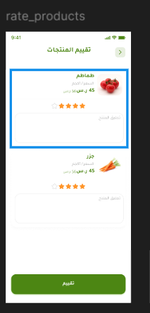
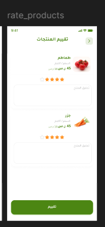
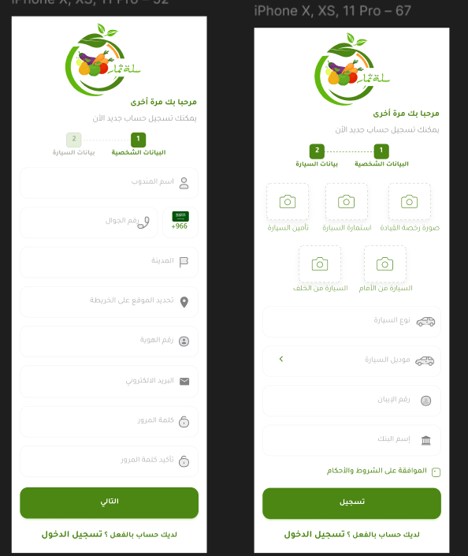
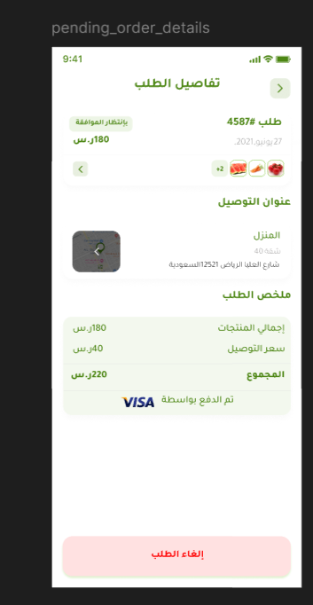
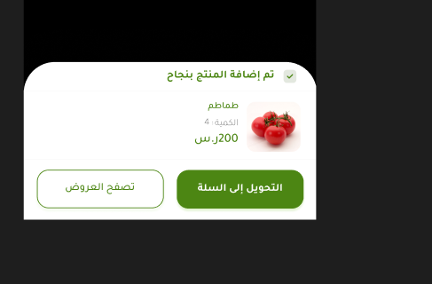
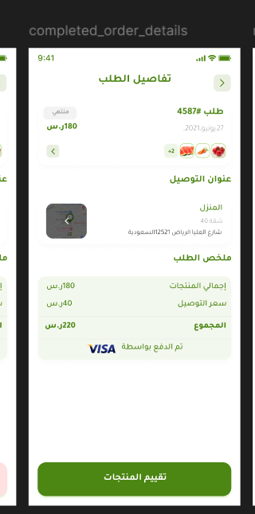
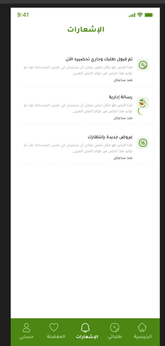
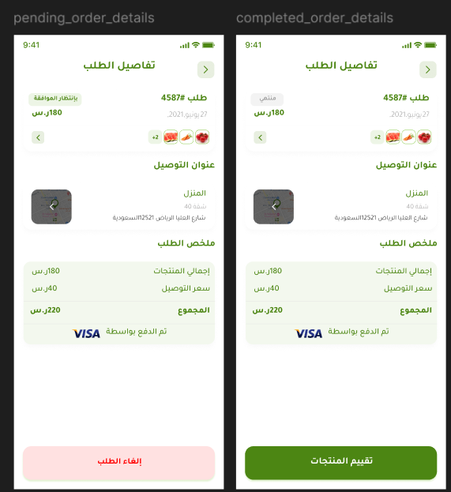

<div align="center">

  

  # 🍎 سلة ثمار | Sala Thimar
  ### منصة التجارة الإلكترونية المتكاملة لتسوق الخضروات والفواكه الطازجة
  **Fresh Groceries Mobile E-Commerce App built with Flutter & Clean Architecture**

  <p align="center">
    
    
    
    
    
    
    
    
  </p>

  <p align="center">
    <b>سلة ثمار</b> هو تطبيق تجارة إلكترونية متطور لشراء الخضروات، الفواكه، التمور، والمواد الغذائية الطازجة مباشرة من المزارع إلى باب المنزل.<br/>
    تم بناء التطبيق بأعلى المعايير البرمجية المعاصرة لتقديم تجربة مستخدم (UX) فائقة السلاسة مع مؤثرات حركية (Lottie Animations) راقية، وتحديد دقيق للموقع الجغرافي (Live GPS Reverse-Geocoding)، وتنسيق احترافي وفق مبادئ <b>Clean Code</b> و <b>SOLID Principles</b>.
  </p>

</div>

---

## 📑 جدول المحتويات | Table of Contents

- [🌟 نظرة عامة | Overview](#-نظرة-عامة--overview)
- [📱 معرض الشاشات | App Screens Showcase](#-معرض-الشاشات--app-screens-showcase)
- [✨ المميزات والخصائص | Key Features](#-المميزات-والخصائص--key-features)
- [🏗️ الهيكلية المعمارية | Architectural Design](#️-الهيكلية-المعمارية--architectural-design)
- [📂 هيكل مجلدات المشروع | Project Structure](#-هيكل-مجلدات-المشروع--project-structure)
- [🛠️ التقنيات والمكتبات المستخدمة | Tech Stack & Libraries](#️-التقنيات-والمكتبات-المستخدمة--tech-stack--libraries)
- [🚀 تشغيل المشروع محلياً | Getting Started](#-تشغيل-المشروع-محلياً--getting-started)
- [👨‍💻 المطور | Author](#-المطور--author)

---

## 🌟 نظرة عامة | Overview

تطبيق **سلة ثمار** يمثل نموذجاً متقدماً لتطبيقات التسوق الإلكتروني باللغة العربية (RTL-First)، حيث يغطي دورة تسوق كاملة:
1. **شاشات تمهيدية متحركة:** شاشة Splash ثلاثية المراحل متبوعة بـ Onboarding تفاعلي مدعوم بـ 3 ملفات Lottie متحركة لشرح مزايا التطبيق.
2. **نظام مصادقة وأمان متكامل:** تسجيل الدخول، إنشاء حساب مع قائمة مدن تفاعلية بالبحث اللحظي، وتأكيد كود الـ OTP ومؤقت إعادة الإرسال الذكي، واستعادة كلمة المرور.
3. **واجهة متجر ذكية وعصرية:** التقاط موقع العميل عبر GPS وتحديد أقرب مدينة للتوصيل ديناميكياً، مع شريط بحث، وبنرات ترويجية، وأقسام، وشبكة منتجات بتأثير تحميل Shimmer فضي احترافي (Silver Skeletonizer).
4. **سلة مشتريات وتتبع طلبات:** حساب دقيق للأسعار، كوبونات الخصم، إتمام الطلب باختيار العنوان وتاريخ/وقت التوصيل وخيارات الدفع المتعددة (نقدي، بطاقة، المحفظة)، مع تتبع حالة الطلب خطوة بخطوة.
5. **الملف الشخصي والمحفظة الرقمية:** إدارة العناوين عبر الخرائط، شحن المحفظة وسجل المعاملات، تقييم المنتجات، الدعم والمساعدة.

---

## 📱 معرض الشاشات | App Screens Showcase

### 1️⃣ تجربة الدخول والمصادقة (Auth & Onboarding)
| شاشة تسجيل الدخول | تأكيد كود التحقق (OTP) | تسجيل حساب جديد |
|:---:|:---:|:---:|
|  |  |  |
| دخول برقم الجوال وكلمة المرور وحفظ التوكن في التخزين الآمن | إدخال كود التحقق عبر 4 خانات PinCode مع مؤقت عد تنازلي | اختيار المدينة عبر BottomSheet مدعوم بالبحث السريع |

---

### 2️⃣ واجهة المتجر الرئيسية والتفاصيل (Home & Products)
| الرئيسية مع تحديد الموقع الفوري | تأثير التحميل الفضي (Skeletonizer) | تفاصيل المنتج والتقييمات |
|:---:|:---:|:---:|
|  |  |  |
| التوصيل إلى أقرب مدينة تلقائياً عبر GPS | تأثير Shimmer فضي متدرج وأنيق ينساب من الجانب | صور، نسبة الخصم، العداد، وإضافة فورية للسلة |

---

### 3️⃣ سلة المشتريات وإدارة الحساب (Cart, Account & Location)
| السلة وإتمام الطلب | الحساب والمحفظة | إدارة العناوين والتوصيل |
|:---:|:---:|:---:|
|  |  |  |
| كوبونات الخصم، حساب الضريبة ورسوم التوصيل | رصيد المحفظة، الإشعارات، وتخصيص البيانات | اختيار وتثبيت العناوين على الخريطة بسهولة |

---

## ✨ المميزات والخصائص | Key Features

### 📍 تحديد الموقع التلقائي للعميل (Live Auto-Geolocation)
- بمجرد الدخول للشاشة الرئيسية، يقوم التطبيق بفحص أذونات الـ GPS عبر `Geolocator`.
- تحويل الإحداثيات الجغرافية (Lat/Lng) إلى اسم المدينة والحي باللغة العربية عبر `Geocoding` وعرضها في الـ AppBar ("التوصيل إلى: الرياض").

### 🎨 مؤثرات وتحميلات متميزة (Silver Shimmer & Lottie)
- استبدال مؤشرات التحميل التقليدية بـ **Silver Skeletonizer Effect** فضي احترافي يحاكي تصميم التطبيق أثناء جلب البيانات من السيرفر.
- شاشة **Splash Animation** متقدمة مع دوران واهتزاز متناسق، وشاشة **Onboarding** مزودة بـ 3 ملفات Lottie لتجربة بصرية فائقة.

### 🏙️ اختيار وفلترة المدن التفاعلية (Searchable City Sheet)
- قائمة مدن قابلة للبحث الفوري (`RegisterCitySheet`) تسحب البيانات ديناميكياً من السيرفر (`/cities/1`) وتتيح للعميل البحث باسم مدينته وتحديدها بنقرة واحدة.

### 🔒 أمان وإدارة توكنات متقدمة (Secure Token Storage)
- تخزين التوكنات الحساسة عبر `flutter_secure_storage` وتخزين التفضيلات والإعدادات السريعة عبر `shared_preferences`.
- اعتراض الطلبات التلقائي (Dio Interceptors) لتضمين الـ Bearer Token تلقائياً في الترويسات.

---

## 🏗️ الهيكلية المعمارية | Architectural Design

تم تصميم المشروع باتباع **Clean Architecture** مع تقسيم **Feature-First** لضمان قابلية الصيانة والتوسع وسهولة الاختبار:

```
lib/
├── _features/                  # كل ميزة معزولة بالكامل (Feature-First)
│   ├── _onborading/            # شاشة البداية والتعريف (Lottie + Indicators)
│   ├── splash/                 # سبلاش سكرين ومحدد المسار الذكي
│   └── client/                 # وحدات وميزات العميل
│       ├── auth/               # تسجيل الدخول، إنشاء الحساب، OTP، استعادة المرور
│       ├── home/               # الرئيسية، البنرات، الأقسام، المنتجات، والـ GPS
│       ├── category_products/  # تصفح وتصنيف المنتجات
│       ├── product_details/    # تفاصيل المنتج والتقييمات
│       ├── cart/               # السلة، الكوبونات وحساب الأسعار
│       ├── orders/             # إتمام الطلب، تفاصيل وتتبع الطلبات
│       ├── favorites/          # قائمة المفضلة السريعة
│       ├── account/            # الحساب الشخصي، تعديل البيانات، والمدن
│       ├── addresses/          # العناوين وحفظ المواقع
│       ├── wallet/             # المحفظة وسجل الشحن
│       ├── notifications/      # مركز الإشعارات والتنبيهات
│       ├── rating/             # تقييم المنتجات
│       └── support/            # سياسة الخصوصية، تواصل معنا، والأسئلة الشائعة
│
└── core/                       # النواة المشتركة للخدمات والأدوات
    ├── caching/                # SecureStorageService & SharedPrefService
    ├── constants/              # ثوابت التطبيق والمفاتيح
    ├── errors/                 # ServerFailure & Error Handling
    ├── extension/              # Spacing & Context Extensions
    ├── routers/                # GoRouter Configuration & AppRouterName
    ├── services/               # ApiService (Dio), FCM, GetIt DI
    ├── theme/                  # AppColors, AppStyles, AppTheme
    ├── utils/                  # AppValidator & Helpers
    └── widgets/                # AppButton, AppInput, AppLoading, Skeleton
```

---

## 🛠️ التقنيات والمكتبات المستخدمة | Tech Stack & Libraries

| المكتبة / الأداة | الغرض والاستخدام |
|:---|:---|
| **[`flutter_bloc`](https://pub.dev/packages/flutter_bloc)** | إدارة حالة التطبيق وفصل طبقات الأعمال (Business Logic) عن واجهات العرض |
| **[`dio`](https://pub.dev/packages/dio)** | إدارة الاتصالات والشبكة، رفع البيانات والملفات عبر `FormData` والتعامل مع REST APIs |
| **[`go_router`](https://pub.dev/packages/go_router)** | التوجيه الذكي بين الشاشات والـ Deep Linking مع انتقالات ناعمة (Page Transitions) |
| **[`get_it`](https://pub.dev/packages/get_it)** | حقن التبعيات (Dependency Injection) بنمط Service Locator |
| **[`flutter_screenutil`](https://pub.dev/packages/flutter_screenutil)** | ضبط التوافق والتجاوب التام لكل قياسات الشاشات والأجهزة المختلفة |
| **[`lottie`](https://pub.dev/packages/lottie)** | تشغيل المؤثرات الحركية الفيكتور عالية الدقة لشاشات الـ Splash والـ Onboarding |
| **[`skeletonizer`](https://pub.dev/packages/skeletonizer)** | عرض شيمر تحميل فضي عصري يحاكي المحتوى الفعلي قبل اكتمال التحميل |
| **[`toastification`](https://pub.dev/packages/toastification)** | إظهار تنبيهات ورسائل النجاح والخطأ التفاعلية والمنسقة بنعومة |
| **[`geolocator`](https://pub.dev/packages/geolocator)** & **[`geocoding`](https://pub.dev/packages/geocoding)** | تحديد موقع المستخدم الجغرافي واستنتاج اسم المدينة والحي بالعربية |
| **[`pin_code_fields`](https://pub.dev/packages/pin_code_fields)** | مربعات إدخال كود الـ OTP المخصصة والآمنة |
| **[`flutter_secure_storage`](https://pub.dev/packages/flutter_secure_storage)** | حفظ توكنات الجلسات (JWT Tokens) في Keychain / KeyStore المشفرة |
| **[`shared_preferences`](https://pub.dev/packages/shared_preferences)** | تخزين الكاش المحلي للحالات والإعدادات السريعة |

---

## 🚀 تشغيل المشروع محلياً | Getting Started

### المتطلبات الأساسية (Prerequisites):
- تثبيت [Flutter SDK](https://docs.flutter.dev/get-started/install) بإصدار `^3.5.0` أو أحدث.
- بيئة تطوير مثل **VS Code** أو **Android Studio** مع تثبيت إضافات Dart & Flutter.

### خطوات التثبيت والتشغيل:

1. **استنساخ المستودع (Clone Repository):**
   ```bash
   git clone https://github.com/NaderSameer33/Sala_Thi3ar.git
   cd Sala_Thi3ar
   ```

2. **تثبيت الحزم والاعتماديات (Install Dependencies):**
   ```bash
   flutter pub get
   ```

3. **التحقق من سلامة الأكواد (Analyze):**
   ```bash
   flutter analyze
   ```
   *(يضمن عدم وجود أي أخطاء أو تحذيرات في الأكواد - 0 Issues)*

4. **تشغيل التطبيق (Run):**
   ```bash
   flutter run
   ```

---

## 👨‍💻 المطور | Author

تم بناء وتطوير المشروع بشغف واحترافية:
- **المطور:** Nader Sameer
- **GitHub:** [@NaderSameer33](https://github.com/NaderSameer33)
- **المشروع:** [Sala_Thi3ar Repository](https://github.com/NaderSameer33/Sala_Thi3ar)

<div align="center">
  <sub>صنع بحب وإتقان باستخدام Flutter 💚</sub>
</div>
