<div align="center">

  

  # 🍎 سلة ثمار | Sala Thimar
  ### منصة التجارة الإلكترونية الشاملة لتسوق الخضروات والفواكه الطازجة
  **A Complete Modern E-Commerce Mobile Application built with Flutter & Clean Architecture**

  <p align="center">
    
    
    
    
    
    
    
    
  </p>

  <p align="center">
    <b>سلة ثمار</b> هو تطبيق تجارة إلكترونية متقدم ومتكامل لشراء وتوصيل الخضروات، الفواكه، اللحوم، التمور، والمواد الغذائية الطازجة يومياً مباشرة من المزارع إلى باب المنزل.<br/>
    صُمم التطبيق بالكامل ليقدم تجربة مستخدم عربية أصيلة (RTL-First)، مدعومة بمؤثرات بصرية وحركية متطورة (Lottie Animations)، وتحديد دقيق للموقع الجغرافي (Auto GPS Reverse-Geocoding)، وتأثير تحميل فضي مبتكر (Silver Skeletonizer)، وهيكلية برمجية احترافية تطبق أحدث مبادئ <b>Clean Code</b> و <b>SOLID Principles</b>.
  </p>

</div>

---

## 📑 فهرس المحتويات | Table of Contents

- [🌟 نظرة عامة على المشروع | Project Overview](#-نظرة-عامة-على-المشروع--project-overview)
- [📱 معرض شاشات التطبيق الكامل (36 شاشة) | Complete Screens Showcase](#-معرض-شاشات-التطبيق-الكامل-36-شاشة--complete-screens-showcase)
  - [1. شاشات البداية والتمهيد (Splash & Welcome)](#1-شاشات-البداية-والتمهيد-splash--welcome)
  - [2. دورة المصادقة والأمان (Authentication & Security)](#2-دورة-المصادقة-والأمان-authentication--security)
  - [3. واجهة المتجر والتسوق الذكي (Store & Shopping Experience)](#3-واجهة-المتجر-والتسوق-الذكي-store--shopping-experience)
  - [4. سلة المشتريات وإتمام الطلب (Cart & Checkout Flow)](#4-سلة-المشتريات-وإتمام-الطلب-cart--checkout-flow)
  - [5. إدارة وتتبع الطلبات والتقييم (Orders Tracking & Rating)](#5-إدارة-وتتبع-الطلبات-والتقييم-orders-tracking--rating)
  - [6. الملف الشخصي وإدارة العناوين (Profile & Address Management)](#6-الملف-الشخصي-وإدارة-العناوين-profile--address-management)
  - [7. المحفظة الرقمية والمعاملات المالية (Digital Wallet & Transactions)](#7-المحفظة-الرقمية-والمعاملات-المالية-digital-wallet--transactions)
  - [8. مركز الإشعارات وخدمة العملاء (Notifications & Customer Support)](#8-مركز-الإشعارات-وخدمة-العملاء-notifications--customer-support)
- [✨ أبرز المزايا التقنية والهندسية | Key Engineering Highlights](#-أبرز-المزايا-التقنية-والهندسية--key-engineering-highlights)
- [🏗️ الهيكلية المعمارية | Architectural Design](#️-الهيكلية-المعمارية--architectural-design)
- [📂 هيكل مجلدات المشروع | Directory Structure](#-هيكل-مجلدات-المشروع--directory-structure)
- [🛠️ التقنيات والمكتبات المستخدمة | Tech Stack](#️-التقنيات-والمكتبات-المستخدمة--tech-stack)
- [🚀 تشغيل المشروع محلياً | Local Setup](#-تشغيل-المشروع-محلياً--local-setup)
- [👨‍💻 المطور | Author](#-المطور--author)

---

## 🌟 نظرة عامة على المشروع | Project Overview

يقدم تطبيق **سلة ثمار** حلاً رقمياً متكاملاً لسوق الأغذية والخضروات الطازجة، حيث يجمع بين:
- **الأداء الفائق وسرعة الاستجابة:** بفضل بنية Cubit الخفيفة ونظام الكاش المتطور للتوكنات والبيانات.
- **التصميم العصري والتجربة التفاعلية:** مكونات مخصصة (Custom Widgets) متجاوبة مع كافة مقاسات الشاشات باستخدام `flutter_screenutil`.
- **التكامل السحابي المباشر:** اتصال بـ RESTful API عبر `Dio` مع معالجة ذكية للأخطاء (Either<Failure, T>) وشبكة أمان ضد انهيار التطبيق.

---

## 📱 معرض شاشات التطبيق الكامل (36 شاشة) | Complete Screens Showcase

---

### 1. شاشات البداية والتمهيد (Splash & Welcome)

| شاشة البداية المتحركة (Splash Screen) |
|:---:|
|  |
| انيميشن متكامل مع حركة الدوران والتكبير والانتقال السلس |

---

### 2. دورة المصادقة والأمان (Authentication & Security)

| تسجيل الدخول (Login) | تسجيل حساب جديد (Register) | تفعيل الحساب (Active Account) |
|:---:|:---:|:---:|
| 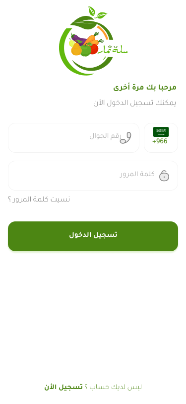 | 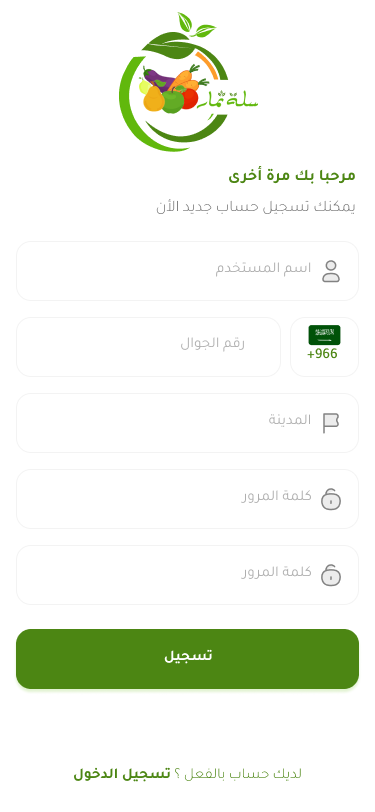 | 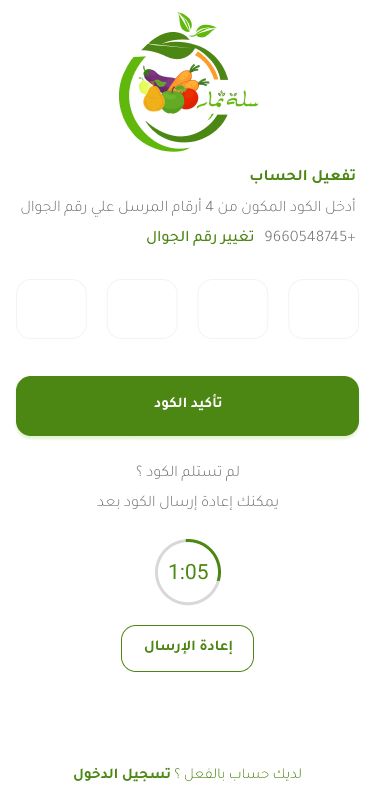 |
| دخول فوري برقم الجوال وكلمة المرور | تسجيل العميل واختيار المدينة بالبحث السريع | واجهة التفعيل المباشر بعد التسجيل |

| تأكيد كود التحقق (Verify OTP) | نسيت كلمة المرور (Forget Password) | تعيين كلمة المرور الجديدة (New Password) |
|:---:|:---:|:---:|
|  |  | 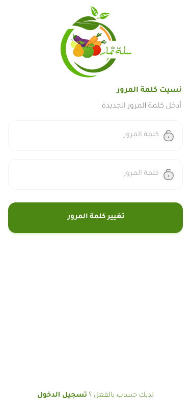 |
| إدخال 4 خانات PinCode مع مؤقت تنازلي | إدخال رقم الجوال لاستلام رمز الاستعادة | تعيين كلمة المرور الجديدة وتأكيدها بأمان |

---

### 3. واجهة المتجر والتسوق الذكي (Store & Shopping Experience)

| الشاشة الرئيسية (Home View) | تصنيفات وأقسام المنتجات (Categories) | تفاصيل المنتج والتقييمات (Product Details) |
|:---:|:---:|:---:|
| 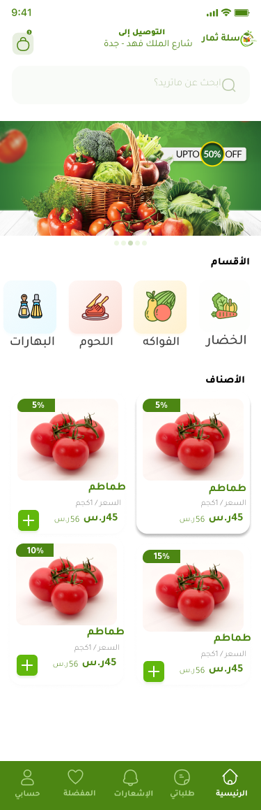 | 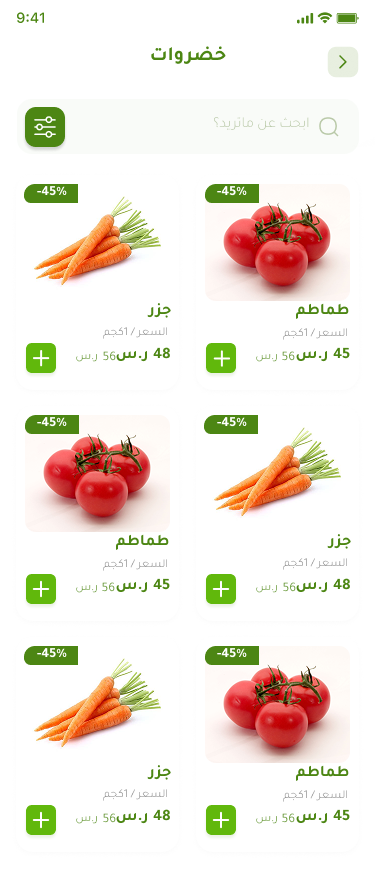 | 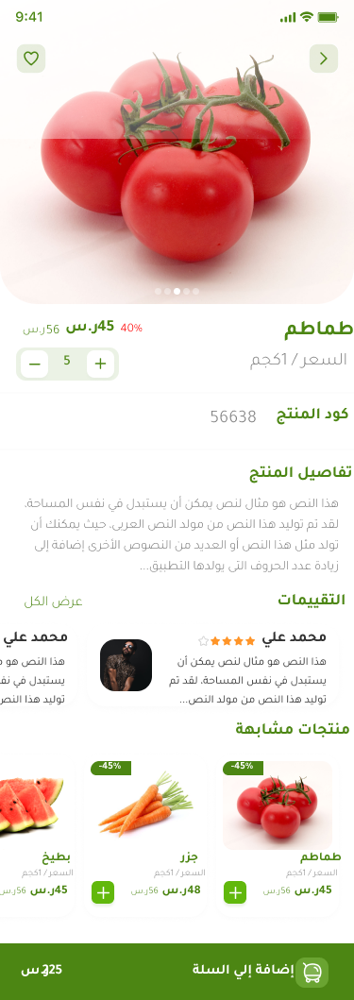 |
| التقاط الموقع الحي، بنرات العروض، والمنتجات | تصفح الأقسام وفلترة المنتجات بدقة | معرض الصور، الخصم، العداد، والتقييمات |

| قائمة المفضلة (Favorites) | فلترة وتصفية المنتجات (Filter Sheet) |
|:---:|:---:|
| 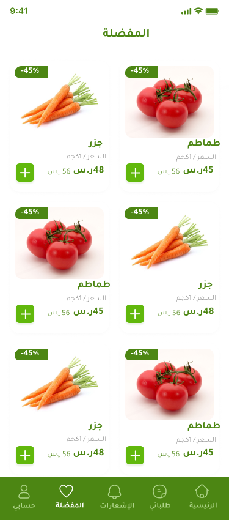 |  |
| حفظ المنتجات المفضلة بنقرة زر والرجوع إليها | فرز حسب السعر، الأحدث، والأعلى تقييماً |

---

### 4. سلة المشتريات وإتمام الطلب (Cart & Checkout Flow)

| إضافة المنتج للسلة (Added Success) | سلة المشتريات (Cart View) | إتمام الطلب (Complete Order) | تأكيد الطلب بنجاح (Order Done) |
|:---:|:---:|:---:|:---:|
|  | 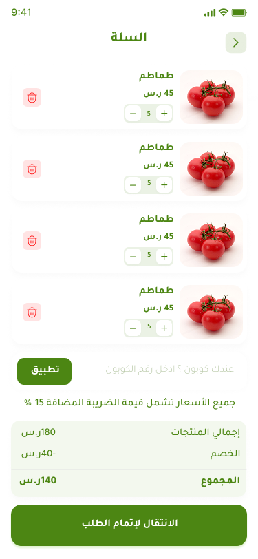 | 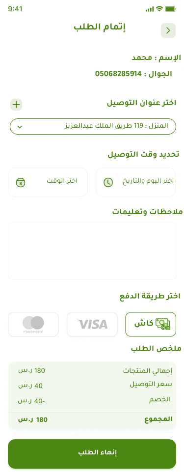 |  |
| تأكيد بصري فوري بإضافة المنتج | الكوبونات، الضريبة، وحساب التوصيل | اختيار العنوان، الموعد، وطريقة الدفع | بطاقة تهنئة بنجاح تقديم الطلب ورقم التتبع |

---

### 5. إدارة وتتبع الطلبات والتقييم (Orders Tracking & Rating)

| الطلبات الحالية (Current Orders) | الطلبات المنتهية (Finished Orders) | تفاصيل طلب قيد التنفيذ (Pending Order) |
|:---:|:---:|:---:|
| 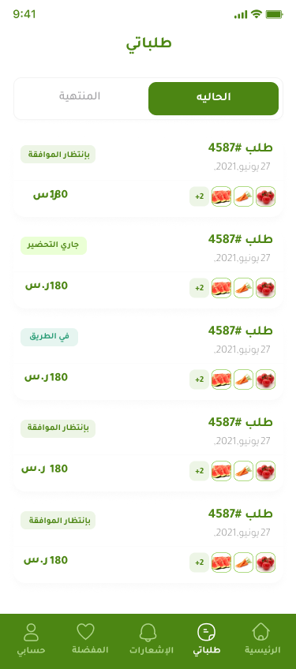 | 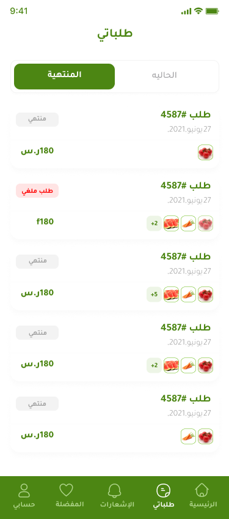 | 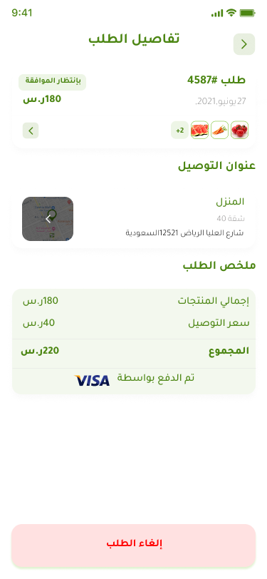 |
| تتبع الطلبات الجارية ومراحل تجهيزها | سجل وأرشيف الطلبات المكتملة مسبقاً | مسار الطلب خطوة بخطوة وإلغاء الطلب |

| تفاصيل الطلب المكتمل (Completed Order) | تقييم المنتجات (Rate Products) |
|:---:|:---:|
| 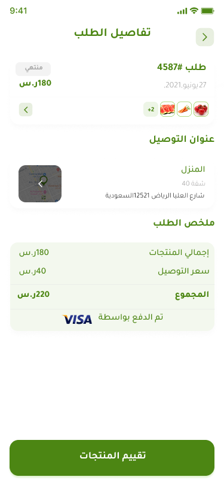 | 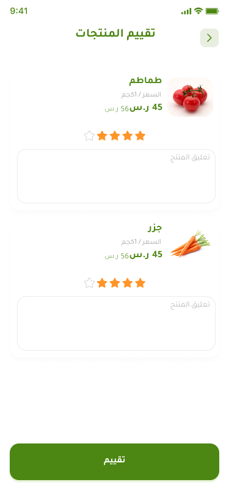 |
| فاتورة الطلب كاملة، الأسعار، وعنوان التوصيل | نظام التقييم بالنجوم وكتابة التعليقات والملاحظات |

---

### 6. الملف الشخصي وإدارة العناوين (Profile & Address Management)

| صفحة حسابي (My Account) | تعديل البيانات الشخصية (Profile Edit) | العناوين المحفوظة (Addresses) | إضافة عنوان جديد (Add Address) |
|:---:|:---:|:---:|:---:|
| 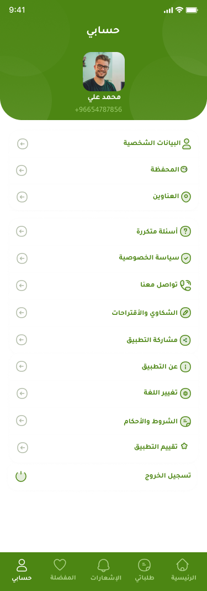 | 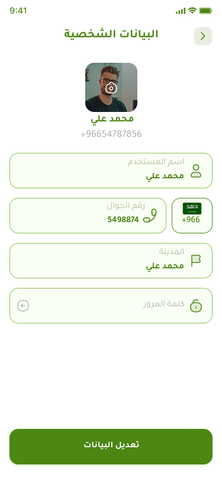 | 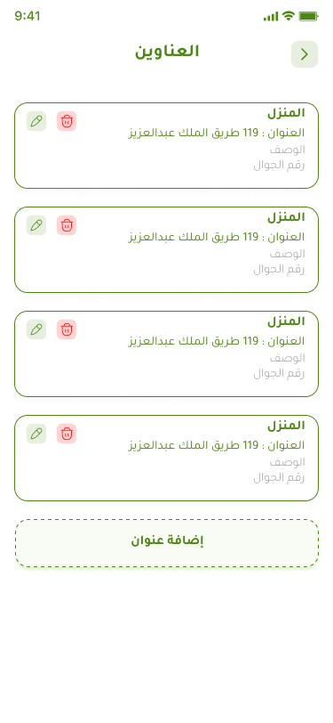 | 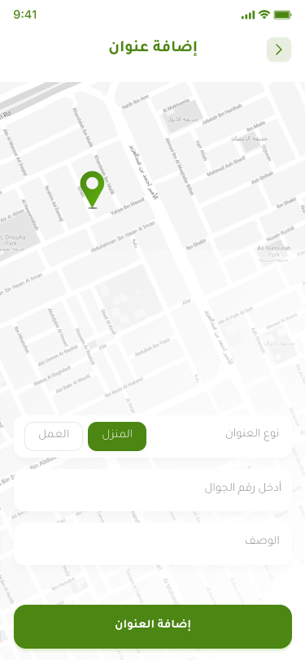 |
| القائمة الرئيسية، رصيد المحفظة، وتسجيل الخروج | تعديل الاسم، الجوال، وتحديث الصورة | قائمة العناوين المحفوظة مع نوع العنوان | تحديد الموقع على الخريطة وإدخال التفاصيل |

---

### 7. المحفظة الرقمية والمعاملات المالية (Digital Wallet & Transactions)

| المحفظة الرقمية (Wallet) | شحن الرصيد فوراً (Charge Now) | سجل المعاملات المالية (Transactions) |
|:---:|:---:|:---:|
| 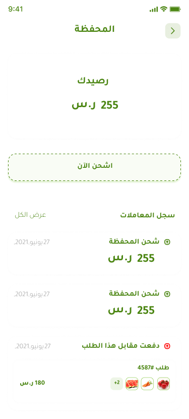 | 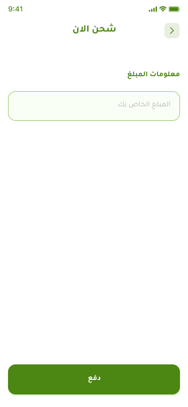 | 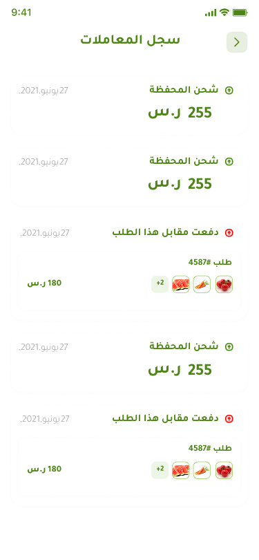 |
| استعراض الرصيد الحالي وإدارة المدفوعات | شحن رصيد المحفظة عبر البطاقات الائتمانية | تفاصيل كافة عمليات الشحن والخصم مع التواريخ |

---

### 8. مركز الإشعارات وخدمة العملاء (Notifications & Customer Support)

| التنبيهات والإشعارات (Notifications) | عن التطبيق (About App) | تواصل معنا (Call Us) |
|:---:|:---:|:---:|
| 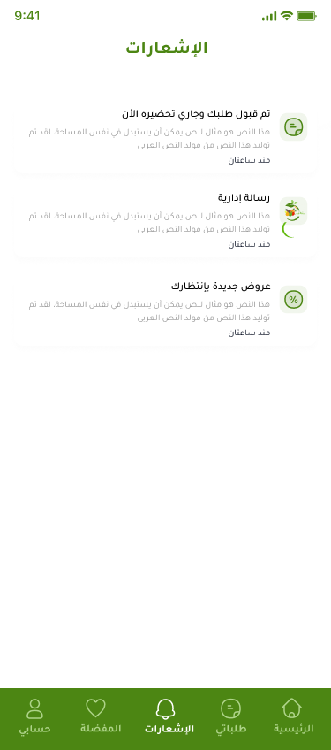 |  | 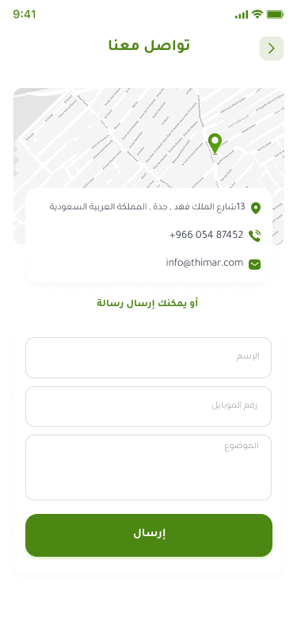 |
| إشعارات لحظية بحالة الطلبات والعروض | نبذة عن رؤية ورسالة سلة ثمار | قنوات التواصل المباشر ورقم خدمة العملاء |

| الأسئلة الشائعة (FAQ) | سياسة الخصوصية (Privacy Policy) | المقترحات والشكاوى (Suggestions) |
|:---:|:---:|:---:|
| 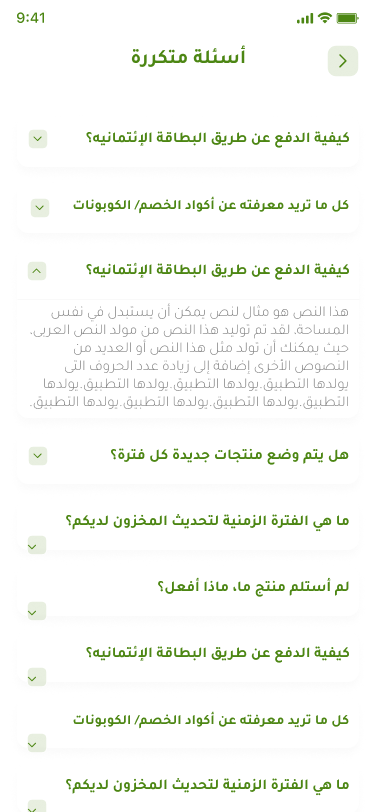 |  | 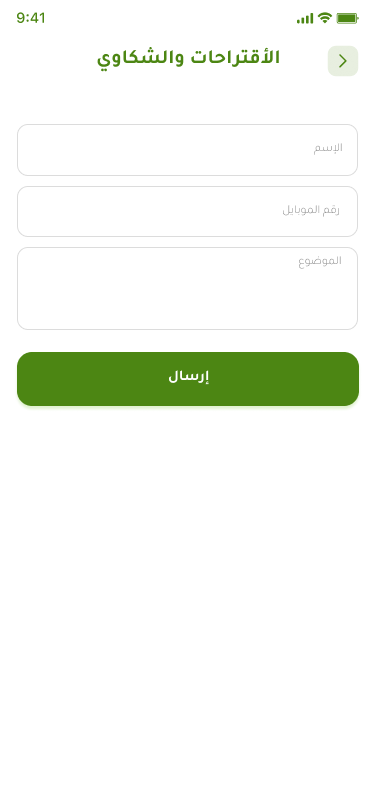 |
| إجابات جاهزة على أكثر الاستفسارات تكراراً | الشروط والأحكام وسياسات حماية البيانات | نموذج إرسال الاقتراحات والملاحظات مباشرة للإدارة |

---

## ✨ أبرز المزايا التقنية والهندسية | Key Engineering Highlights

### 📍 تحديد الموقع الجغرافي الفوري (Auto Reverse-Geocoding)
- عند فتح التطبيق، يتم الاستعلام عن إحداثيات موقع العميل عبر `Geolocator`.
- تحويل الإحداثيات إلى اسم المدينة والحي باللغة العربية عبر `Geocoding` وعرضها أعلى الواجهة الرئيسية لبيان موقع التوصيل الفعلي للمستخدم.

### 🎨 شيمر تحميل فضي متطور (Silver Skeletonizer)
- تم استبدال مؤشرات التحميل الدائرية المعتادة بتأثير **Silver Shimmer Skeletonizer** فضي متدرج يعكس هيكل البطاقات الحقيقي أثناء جلب المنتجات والأقسام، مما يعطي تجربة استخدام انسيابية دون أي فراغات مفاجئة.

### 🏙️ اختيار المدن التفاعلي بالبحث اللحظي (Searchable City Sheet)
- ميزة البحث الفوري داخل قائمة المدن؛ حيث يقوم التطبيق بجلب المدن من الـ API (`/cities/1`)، ويمكّن المستخدم من كتابة اسم مدينته للوصول السريع واختيارها لتسجيل حسابه بكل سهولة.

### 🎬 شاشة Onboarding ثلاثية الأبعاد بـ Lottie Animations
- سلايدر تمهيدي يحتوي على 3 مشاهد كرتونية متفاعلة باستخدام Lottie:
  1. **خضروات وفواكه طازجة يومياً** (شعار الجودة والنظافة).
  2. **تسوق كل احتياجاتك بلمسة واحدة** (سهولة التصفح والدفع).
  3. **توصيل سريع حتى باب منزلك** (أسطول توصيل سريع ومحترف).
- مؤشر صفحات ذكي يتمدد بنعومة (`AnimatedContainer`)، مع زر تخطي وإمكانية بدء التسوق بضغطة واحدة.

---

## 🏗️ الهيكلية المعمارية | Architectural Design

يتبع المشروع معمارية **Clean Architecture** الموصى بها رسمياً، مع تنظيم بنمط **Feature-First**:

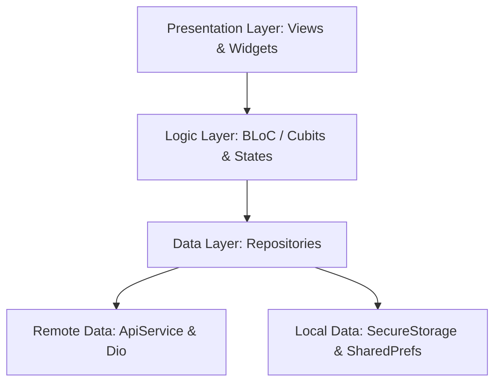

### 1. طبقة العرض (Presentation Layer):
- واجهات رسومية مقسمة إلى شاشات ومكونات فرعية قابلة لإعادة الاستخدام.
- إدارة الحالة بالكامل باستخدام `Cubit` و `BlocConsumer`.

### 2. طبقة المنطق (Logic Layer):
- كل ميزة تحتوي على Cubit خاص بها مزود بميكسن `SafeEmitMixin` لمنع إصدار أي حالات بعد إغلاق الشاشة.

### 3. طبقة البيانات (Data Layer):
- نماذج البيانات (Models) مع دوال التحويل `fromJson` و `toFormData`.
- مستودعات البيانات (Repositories) التي تستقبل رد السيرفر وتلفه بنمط `Either<Failure, T>` لضمان معالجة دقيقة للأخطاء.

---

## 📂 هيكل مجلدات المشروع | Directory Structure

```bash
lib/
├── _features/
│   ├── _onborading/           # السلايدر التفاعلي، مؤشر الصفحات، ونماذج Lottie
│   ├── splash/                # شاشة السبلاش مع متحكمات الحركة المتقدمة
│   └── client/
│       ├── auth/              # تسجيل الدخول، إنشاء الحساب، الـ OTP، واستعادة المرور
│       ├── home/              # الصفحة الرئيسية، البنرات، الأقسام، والـ GPS
│       ├── category_products/ # تصفح المنتجات حسب القسم المحدد
│       ├── product_details/   # صفحة تفاصيل المنتج، الصور، والتقييمات
│       ├── cart/              # سلة التسوق، الكوبونات، وحساب الأسعار
│       ├── orders/            # إتمام الطلب، العناوين، تتبع الطلبات، وتأكيد الشراء
│       ├── favorites/         # قائمة المنتجات المفضلة
│       ├── account/           # الملف الشخصي، تعديل البيانات، وقائمة المدن
│       ├── addresses/         # العناوين المحفوظة وتحديد الموقع على الخريطة
│       ├── wallet/            # المحفظة الرقمية، شحن الرصيد، وسجل المعاملات
│       ├── notifications/     # مركز الإشعارات والتنبيهات الحية
│       ├── rating/            # تقييم المنتجات بالنجوم والتعليقات
│       └── support/           # عن التطبيق، الشروط، الأسئلة الشائعة، وتواصل معنا
│
└── core/                      # النواة المركزية المشتركة
    ├── caching/               # إدارة التوكنات والكاش (SecureStorage & SharedPreferences)
    ├── constants/             # الثوابت وروابط الـ API ومفاتيح التخزين
    ├── errors/                # معالجة استثناءات Dio والـ ServerFailure
    ├── extension/             # دوال التوسيع للمسافات والسياق
    ├── routers/               # إعدادات GoRouter والانتقالات السلسة
    ├── services/              # ApiService، Firebase Messaging، و GetIt Service Locator
    ├── theme/                 # ثيم التطبيق، الألوان الموحدة (AppColors)، والخطوط (AppStyles)
    ├── utils/                 # التحقق من المدخلات (AppValidator)
    └── widgets/               # الأزرار والحقول الموحدة (AppButton, AppInput, AppLoading)
```

---

## 🛠️ التقنيات والمكتبات المستخدمة | Tech Stack

| المكتبة | الإصدار | الوظيفة |
|:---|:---:|:---|
| **[`flutter_bloc`](https://pub.dev/packages/flutter_bloc)** | `^8.1.6` | إدارة الحالة الفعالة مع فصل الـ Business Logic |
| **[`dio`](https://pub.dev/packages/dio)** | `^5.7.0` | التعامل مع طلبات الـ HTTP ورفع ملفات `multipart/form-data` |
| **[`go_router`](https://pub.dev/packages/go_router)** | `^14.6.2` | نظام توجيه متطور وسلس مع دعم الـ Transitions المخصصة |
| **[`get_it`](https://pub.dev/packages/get_it)** | `^8.0.2` | Service Locator لحقن التبعيات وإدارتها مركزياً |
| **[`flutter_screenutil`](https://pub.dev/packages/flutter_screenutil)** | `^5.9.3` | تجاوب كامل على مختلف أحجام الهواتف والتابلت |
| **[`lottie`](https://pub.dev/packages/lottie)** | `^3.1.3` | تشغيل ملفات الأنيميشن الفيكتور في السبلاش والـ Onboarding |
| **[`skeletonizer`](https://pub.dev/packages/skeletonizer)** | `^1.4.2` | تأثير تحميل فضي عصري وانسيابي (Shimmer) |
| **[`toastification`](https://pub.dev/packages/toastification)** | `^2.3.0` | تنبيهات وإشعارات سريعة بنمط Toast عصري وأنيق |
| **[`geolocator`](https://pub.dev/packages/geolocator)** & **[`geocoding`](https://pub.dev/packages/geocoding)** | `^13.0.2` | استخراج الإحداثيات الجغرافية واستنتاج اسم المدينة بالعربية |
| **[`pin_code_fields`](https://pub.dev/packages/pin_code_fields)** | `^8.0.1` | حقول إدخال رمز التحقق التلقائي (OTP) |
| **[`flutter_secure_storage`](https://pub.dev/packages/flutter_secure_storage)** | `^9.2.2` | حفظ التوكنات والبيانات الحساسة بتشفير تام |

---

## 🚀 تشغيل المشروع محلياً | Local Setup

### 1. استنساخ المستودع (Clone Repository):
```bash
git clone https://github.com/NaderSameer33/Sala_Thi3ar.git
cd Sala_Thi3ar
```

### 2. تحميل الحزم (Get Dependencies):
```bash
flutter pub get
```

### 3. فحص ومراجعة الكود (Code Analysis):
```bash
flutter analyze
```
*(تم التحقق من الكود بالكامل مع الحصول على: **No issues found!**)*

### 4. تشغيل التطبيق (Run Application):
```bash
flutter run
```

---

## 👨‍💻 المطور | Author

- **المطور:** Nader Sameer
- **GitHub:** [@NaderSameer33](https://github.com/NaderSameer33)
- **المستودع الرسمي:** [GitHub Repository - Sala_Thi3ar](https://github.com/NaderSameer33/Sala_Thi3ar)

<div align="center">
  <sub>تم التطوير بكل حب وإتقان بواسطة Flutter 💚</sub>
</div>
